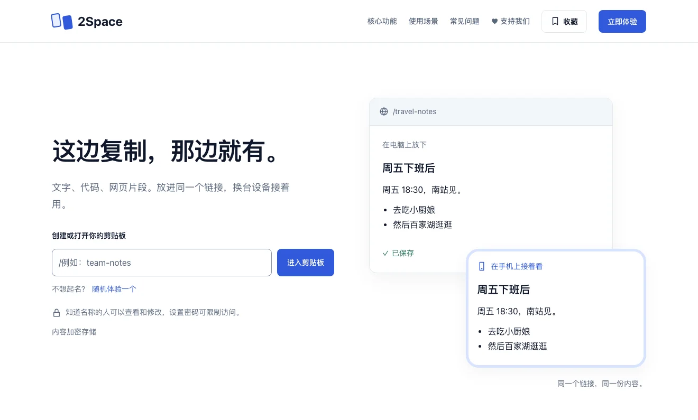

# 2Space

[简体中文](README.md) · [English](README.en.md) · [日本語](README.ja.md) · [Français](README.fr.md) · Deutsch

**Hier kopieren, dort weitermachen.** 2Space ist eine selbst hostbare Online-Zwischenablage. Öffnen Sie denselben Bereich auf mehreren Geräten, um Text, formatierten Text und Code zu übertragen.



## Starten

Führen Sie den folgenden Befehl im Stammverzeichnis des Repositorys aus. Docker Engine oder Docker Desktop muss laufen. Sie benötigen Docker Compose v2 oder neuer mit Unterstützung für `--wait`. Für den Build ist Zugriff auf Docker Hub und die npm-Registry erforderlich. Auf dem Host muss kein Node.js installiert sein.

```sh
docker compose up --build --detach --wait --wait-timeout 90
```

Öffnen Sie [http://localhost:3210](http://localhost:3210). Standardmäßig ist der Dienst nur lokal erreichbar. Ist Port 3210 belegt, setzen Sie `PORT=3211` vor den Startbefehl und öffnen Sie die Adresse mit diesem Port.

```sh
docker compose logs --tail=60 app
docker compose down
```

SQLite speichert die Daten im benannten Volume `space-data`. Sie bleiben beim Anhalten, Neustarten und Neuerstellen der Container erhalten. Sichern Sie vor einem Update die Daten und führen Sie denselben Startbefehl aus dem aktualisierten Repository aus. Verwenden Sie `docker compose down -v` nur, wenn Sie die gespeicherten Daten löschen möchten.

Für den Zugriff von anderen Geräten richten Sie auf dem Docker-Host einen HTTPS-Reverse-Proxy ein und verwenden auf allen Geräten dieselbe HTTPS-Adresse. Siehe [Reverse-Proxy, Datensicherung und Wiederherstellung (vereinfachtes Chinesisch)](docs/SELF-HOSTING.md).

## Funktionen

- Bis zu sechs Notizen pro Bereich. Sie können die Notizen benennen und neu anordnen. Änderungen werden automatisch gespeichert und mit Geräten synchronisiert, auf denen der Bereich geöffnet ist.
- Beim Einfügen bleiben gängige Formatierungen erhalten. Codeblöcke unterstützen Syntaxhervorhebung, Zeilennummern, Einrückung per Tastatur und das Kopieren des Originaltexts.
- Öffnen Sie Bereiche per Link oder QR-Code. Inhalte lassen sich kopieren und als TXT herunterladen. Sie können eine Aufbewahrungsdauer und ein Passwort festlegen oder den Bereich manuell löschen.
- Die Oberfläche ist auf vereinfachtem Chinesisch, Englisch, Japanisch, Französisch und Deutsch verfügbar. Standardmäßig folgt sie der Browsersprache und kann manuell umgestellt werden.

## Teilen und Passwörter

Wer den Namen eines gewöhnlichen Bereichs kennt, kann ihn ansehen und bearbeiten. `?readonly` öffnet die Leseansicht. Über den Namen bleibt die Bearbeitungsansicht erreichbar. Bei gewöhnlichen Bereichen speichert der Server verschlüsselte Inhalte und hält den Inhaltsschlüssel.

Wenn Sie in der aktuellen Oberfläche ein Passwort festlegen, leitet der Browser den Inhaltsschlüssel ab und verschlüsselt die Inhalte erneut. Der Server speichert verschlüsselte Inhalte und die zur Authentifizierung nötigen Daten. Vergessene Passwörter lassen sich nicht wiederherstellen. Bestehende Links im alten Format behalten ihre Berechtigungen. Durch erneutes Festlegen des Passworts können Sie den alten Passwortschutz aktualisieren. Bewahren Sie alte Bearbeitungs- und Leselinks sicher auf, da sie den jeweiligen Zugriff gewähren. Ablauf, Löschung und Widerruf können bereits erstellte Kopien beim Empfänger nicht zurückholen.

## Entwicklung und Betrieb

2Space verwendet React, Tiptap, Fastify und SQLite. Ein Container stellt die Weboberfläche und die API bereit. Die Synchronisierung nutzt SSE. Verwenden Sie pro Datenbank eine Anwendungsinstanz. Die lokale Entwicklung setzt Node.js 24 voraus.

```sh
npm ci
npm run typecheck
npm test
npm run build
```

Für die Entwicklung mit Docker halten Sie den oben gestarteten Dienst an, führen `docker compose -f compose.dev.yaml up --build` aus und öffnen [http://localhost:5173](http://localhost:5173). Dabei wird ein separates Datenvolume verwendet.

Dokumentation auf vereinfachtem Chinesisch · [Entwicklung](docs/DEVELOPMENT.md) · [Architektur](docs/ARCHITECTURE.md) · [API](docs/API.md) · [Passwortschutz im Browser](docs/decisions/006-browser-password-protection.md)
