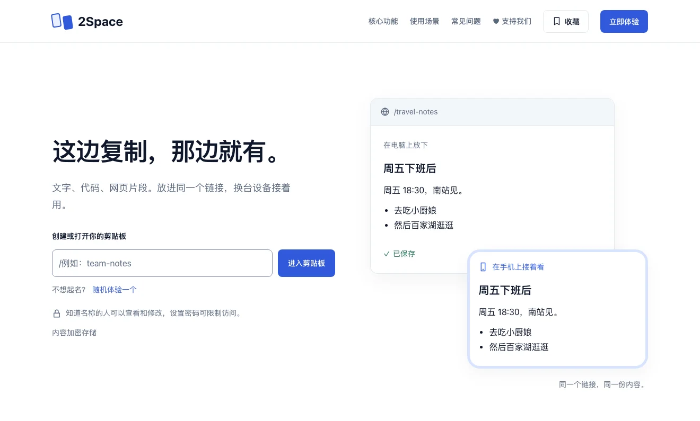

# 2Space

English · [简体中文](README.md)

**Copy here. Pick it up there.** 2Space is a self-hosted clipboard for text, rich text, and code. Open the same named space on another device to pick up where you left off.



## Start with one command

Run this from the repository root. You'll need a running Docker Engine or Docker Desktop and Docker Compose v2 or newer with support for `--wait`. The build needs access to Docker Hub and the npm registry. You can run it without installing Node.js on the host.

```sh
docker compose up --build --detach --wait --wait-timeout 90
```

Once the command succeeds, open [http://localhost:3210](http://localhost:3210). The app listens on the host's loopback interface by default. If port 3210 is in use, prefix the command with `PORT=3211` and open the app on that port.

```sh
docker compose logs --tail=60 app
docker compose down
```

SQLite data lives in the `space-data` named volume and survives container stops, restarts, and rebuilds. To update, back up your data and run the same startup command from the updated checkout. Use `docker compose down -v` only when you intend to delete the stored data.

For phones and other devices, configure an HTTPS reverse proxy on the Docker host and use the same HTTPS address across devices. See [reverse proxy setup, backups, and recovery](docs/SELF-HOSTING.md).

## Features

- Keep up to six named, reorderable notes in a space. Changes save automatically and sync to other devices with the same space open.
- Preserve common formatting when pasting rich text. Code blocks support syntax highlighting, line numbers, keyboard indentation, and copying the original text.
- Open spaces through links or QR codes, copy content, and download plain text. Set an expiration or a space password, or delete the space manually.
- The app interface is in Simplified Chinese. It handles text, basic rich text, and code.

## Sharing and passwords

Anyone who knows an ordinary space's name can view and edit it. Adding `?readonly` opens a viewing interface. Anyone with the name can still open the editable page. Ordinary spaces store encrypted content with the content key held by the server.

Setting a password in the current interface derives the content key in the browser and re-encrypts the content. The server stores ciphertext and the data needed for authentication. Forgotten passwords cannot be recovered. Legacy links keep their original permissions, and legacy password protection can be upgraded by setting a new password. Keep legacy edit and view links safe, since those links grant the corresponding access. Expiry, deletion, and revocation cannot recall copies a recipient has already made.

## Development and maintenance

2Space uses React, Tiptap, Fastify, and SQLite. One container serves the web app and API. Live updates use server-sent events (SSE). Run one application instance per database.

```sh
npm ci
npm run typecheck
npm test
npm run build
```

To develop with Docker, stop the service above, run `docker compose -f compose.dev.yaml up --build`, and open [http://localhost:5173](http://localhost:5173). Development uses a separate data volume.

Local development requires Node.js 24. See the Chinese-language [development guide](docs/DEVELOPMENT.md), [architecture notes](docs/ARCHITECTURE.md), [API reference](docs/API.md), and [browser password protection design](docs/decisions/006-browser-password-protection.md).
