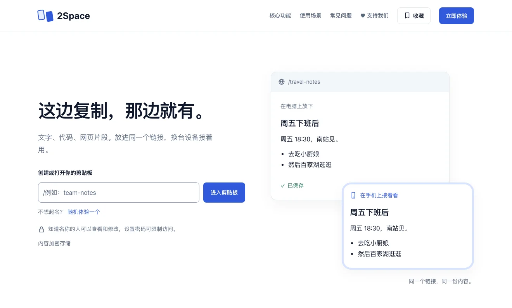

# 2Space

[简体中文](README.md) · [English](README.en.md) · [日本語](README.ja.md) · Français · [Deutsch](README.de.md)

**Copiez ici, retrouvez ailleurs.** 2Space est un presse-papiers en ligne auto-hébergeable. Ouvrez le même espace sur plusieurs appareils pour retrouver votre texte, votre texte mis en forme ou votre code.



## Démarrage

Depuis la racine du dépôt, exécutez la commande suivante. Docker Engine ou Docker Desktop doit être en cours d’exécution. Utilisez Docker Compose v2 ou une version ultérieure prenant en charge `--wait`. La compilation nécessite l’accès à Docker Hub et au registre npm. L’installation de Node.js sur l’hôte est facultative.

```sh
docker compose up --build --detach --wait --wait-timeout 90
```

Ouvrez [http://localhost:3210](http://localhost:3210). Par défaut, le service est accessible localement. Si le port 3210 est occupé, ajoutez `PORT=3211` devant la commande et ouvrez l’adresse sur ce port.

```sh
docker compose logs --tail=60 app
docker compose down
```

Les données SQLite sont stockées dans le volume nommé `space-data`. Elles persistent après l’arrêt, le redémarrage ou la reconstruction des conteneurs. Pour mettre à jour 2Space, sauvegardez les données et relancez la commande depuis la nouvelle version du dépôt. Exécutez `docker compose down -v` uniquement si vous souhaitez supprimer les données.

Pour accéder à 2Space depuis d’autres appareils, configurez un proxy inverse HTTPS sur l’hôte Docker et utilisez la même adresse HTTPS partout. Consultez le [guide du proxy inverse, des sauvegardes et de la restauration (chinois simplifié)](docs/SELF-HOSTING.md).

## Fonctionnalités

- Chaque espace peut contenir jusqu’à six notes que vous pouvez nommer et réorganiser. Les modifications sont enregistrées automatiquement et synchronisées sur les appareils où l’espace est ouvert.
- Le collage conserve les mises en forme courantes. Les blocs de code proposent la coloration syntaxique, les numéros de ligne, l’indentation au clavier et la copie du code d’origine.
- Ouvrez un espace à l’aide d’un lien ou d’un QR code, copiez le contenu ou téléchargez-le au format TXT. Vous pouvez définir une date d’expiration, ajouter un mot de passe ou supprimer l’espace.
- L’interface est disponible en chinois simplifié, anglais, japonais, français et allemand. Elle suit par défaut la langue du navigateur et permet de choisir une autre langue.

## Partage et mots de passe

Toute personne connaissant le nom d’un espace ordinaire peut le consulter et le modifier. Le paramètre `?readonly` ouvre l’interface de consultation. Le nom donne toujours accès à l’interface de modification. Dans un espace ordinaire, le serveur conserve le contenu chiffré et la clé de contenu.

Lorsque vous définissez un mot de passe depuis l’interface actuelle, le navigateur dérive la clé de contenu et chiffre à nouveau les notes. Le serveur conserve les données chiffrées et les informations nécessaires à l’authentification. Un mot de passe oublié est irrécupérable. Les anciens liens conservent leurs autorisations et l’ancienne protection peut être mise à niveau en redéfinissant le mot de passe. Conservez soigneusement les anciens liens de modification et de consultation, qui accordent les accès correspondants. L’expiration, la suppression et la révocation du partage ne retirent pas les copies déjà réalisées par le destinataire.

## Développement et maintenance

2Space utilise React, Tiptap, Fastify et SQLite. Un même conteneur sert l’interface Web et l’API. Les mises à jour sont transmises par SSE. Exécutez une seule instance par base de données. Le développement local nécessite Node.js 24.

```sh
npm ci
npm run typecheck
npm test
npm run build
```

Pour développer avec Docker, arrêtez le service ci-dessus, exécutez `docker compose -f compose.dev.yaml up --build` et ouvrez [http://localhost:5173](http://localhost:5173). Le développement utilise un volume de données distinct.

Documentation en chinois simplifié · [Développement](docs/DEVELOPMENT.md) · [Architecture](docs/ARCHITECTURE.md) · [API](docs/API.md) · [Protection par mot de passe dans le navigateur](docs/decisions/006-browser-password-protection.md)
