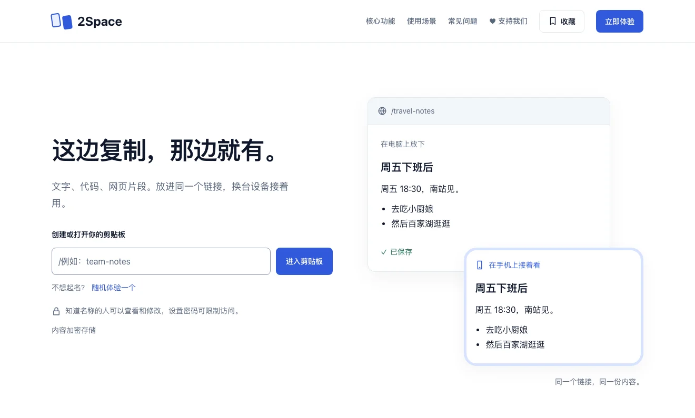

# 2Space

[简体中文](README.md) · [English](README.en.md) · 日本語 · [Français](README.fr.md) · [Deutsch](README.de.md)

**ここでコピー、別の端末で続きから。** 2Space はセルフホストできるオンラインクリップボードです。同じスペース名を使って、テキスト、書式付きテキスト、コードを端末間でやり取りできます。



## 起動

Docker Engine または Docker Desktop を起動し、`--wait` に対応した Docker Compose v2 以降を用意します。リポジトリのルートで次を実行します。ビルドには Docker Hub と npm レジストリへの接続が必要です。ホストへの Node.js のインストールは不要です。

```sh
docker compose up --build --detach --wait --wait-timeout 90
```

[http://localhost:3210](http://localhost:3210) を開きます。既定ではローカルからのみ接続できます。ポート 3210 が使用中なら、起動コマンドの前に `PORT=3211` を付け、そのポートを開きます。

```sh
docker compose logs --tail=60 app
docker compose down
```

SQLite のデータは名前付きボリューム `space-data` に保存され、コンテナの停止、再起動、再ビルド後も残ります。更新前にバックアップし、更新後のソースで起動コマンドを再実行してください。`docker compose down -v` はデータを削除する場合にだけ使用してください。

他の端末から使うには、Docker ホストに HTTPS リバースプロキシを設定し、各端末で同じ HTTPS アドレスを開きます。[リバースプロキシ、バックアップ、復元（簡体字中国語）](docs/SELF-HOSTING.md)を参照してください。

## 機能

- 1 スペースに最大 6 件のメモを保存でき、名前や順序を変更できます。編集は自動保存され、同じスペースを開いている端末に同期されます。
- よく使う貼り付け書式を保持します。コードブロックは構文強調、行番号、キーボードでのインデント、原文のコピーに対応しています。
- リンクや QR コードで開き、コピーや TXT のダウンロードができます。保存期間やパスワードの設定、スペースの削除もできます。
- UI は簡体字中国語、英語、日本語、フランス語、ドイツ語に対応します。既定ではブラウザーの言語を使い、画面から変更できます。

## 共有とパスワード

通常のスペースは名前を知っている人が閲覧・編集できます。`?readonly` は閲覧画面を開く指定です。名前を知っていれば編集画面も開けます。通常のスペースでは、暗号化した本文と本文の鍵をサーバーに保存します。

現在の画面からパスワードを設定すると、ブラウザーが本文の鍵を導出し、本文を再暗号化します。サーバーには暗号化された本文と認証用データが保存されます。忘れたパスワードは復元できません。旧形式のリンクは従来の権限を維持します。旧形式のパスワード保護はパスワードの再設定で更新できます。編集用・閲覧専用の旧リンクは対応する権限を持つため、大切に保管してください。有効期限切れ、削除、共有の取り消し後も、相手が作成済みのコピーは回収できません。

## 開発と運用

React、Tiptap、Fastify、SQLite を使用します。1 つのコンテナが Web UI と API を提供し、同期には SSE を使います。データベースごとにアプリを 1 インスタンスで実行します。ローカル開発には Node.js 24 が必要です。

```sh
npm ci
npm run typecheck
npm test
npm run build
```

Docker で開発する場合は上のサービスを停止し、`docker compose -f compose.dev.yaml up --build` を実行して [http://localhost:5173](http://localhost:5173) を開きます。開発環境は別のデータボリュームを使います。

関連資料（簡体字中国語）　[開発ガイド](docs/DEVELOPMENT.md) · [構成](docs/ARCHITECTURE.md) · [API](docs/API.md) · [ブラウザーでのパスワード保護](docs/decisions/006-browser-password-protection.md)
