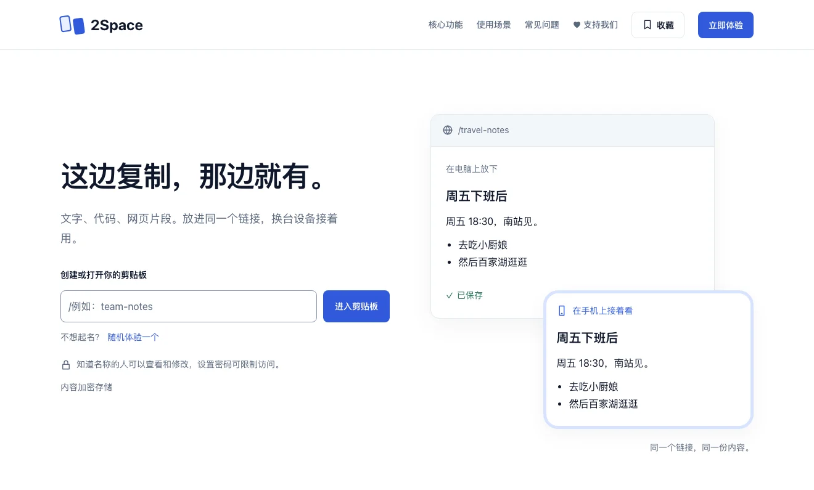

# 2Space

[English](README.en.md) · 简体中文

**这边复制，那边就有。** 2Space 是可自托管的跨设备在线剪贴板。用同一个空间名在不同设备打开，随手保存文字、富文本和代码。



## 一键启动

在仓库根目录运行以下命令。需要正在运行的 Docker Engine 或 Docker Desktop，以及支持 `--wait` 的 Docker Compose v2 或更新版本。构建时需要访问 Docker Hub 和 npm registry，宿主机无需安装 Node.js。

```sh
docker compose up --build --detach --wait --wait-timeout 90
```

命令成功后打开 [http://localhost:3210](http://localhost:3210)。默认只监听本机。若 3210 被占用，可在命令前加 `PORT=3211`，之后也用这个端口访问。

```sh
docker compose logs --tail=60 app
docker compose down
```

SQLite 数据保存在 `space-data` 命名卷中，停止、重启和重建容器后仍可使用。更新前先备份数据，再在新版源码目录运行同一条启动命令。只有确定要删除数据时才使用 `docker compose down -v`。

要让手机或其他设备访问，请在 Docker 宿主机上配置 HTTPS 反向代理，使设备使用同一个 HTTPS 地址。查看[反向代理、备份与恢复](docs/SELF-HOSTING.md)。

## 能做什么

- 一个空间最多放 6 份笔记，可命名和排序。自动保存，其他设备打开同一空间时可收到更新。
- 保留常用粘贴格式。代码块支持语法高亮、行号、键盘缩进和原文复制。
- 通过链接或二维码打开，支持复制和下载 TXT。可设置保留期限、空间密码或手动删除。
- 界面支持简体中文、英语、日语、法语和德语。默认跟随浏览器语言，也可手动切换。

## 分享与密码

普通空间凭名称即可查看和编辑。分享地址的 `?readonly` 只切换查看界面。知道空间名称的人仍能进入可编辑页面。普通空间的正文虽以密文保存，服务端持有正文密钥。

通过当前界面设置密码时，浏览器派生正文密钥并重新加密。服务端保存密文和验证所需的数据。密码忘记后无法找回。旧版空间链接仍按原权限工作，旧版密码门禁可通过重新设置密码升级。请妥善保存旧版可编辑及仅查看链接，它们携带相应权限。到期、删除和撤销都无法收回接收方已复制的内容。

## 开发与维护

应用由 React、Tiptap、Fastify 和 SQLite 组成。单个容器同时提供页面和 API，多设备同步使用 SSE。支持单实例部署。

```sh
npm ci
npm run typecheck
npm test
npm run build
```

只用 Docker 开发时，先停止上面的服务，再运行 `docker compose -f compose.dev.yaml up --build`，打开 [http://localhost:5173](http://localhost:5173)。开发环境使用独立数据卷。

本地开发需要 Node.js 24。Docker 开发、架构和兼容性测试见[开发规范](docs/DEVELOPMENT.md)、[架构](docs/ARCHITECTURE.md)、[API](docs/API.md)和[浏览器密码保护](docs/decisions/006-browser-password-protection.md)。

## 许可证

2Space 使用 [MIT 许可证](LICENSE)。
