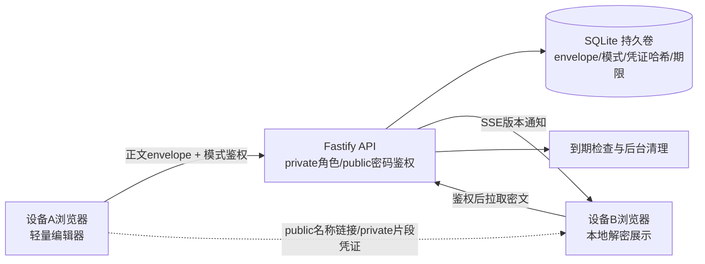

# 2Space 1.0 架构

> 当前增量基线：2026-10-29用户明确选择新建空间凭名称查看和修改、密码可选。新public默认永久，`?readonly`仅页面模式；旧private空间和旧链接保持原权限与加密边界。最新需求、API和验收范围见[JIANLA-PARITY.md](JIANLA-PARITY.md)；历史命名短分享设计保留在SHORT-LINKS.md和ADR中。

## 信任边界

浏览器持有明文和正文密钥。旧private凭证只有哈希入库，正文密钥不发给服务端；新public由服务端保存publicKey，并在可选空间密码门禁后提供给浏览器。public服务端能还原正文，不能宣传为端到端私密。URL fragment不会随普通HTTP请求发给服务端，但浏览器历史/扩展/剪贴板可接触完整链接。页面no-referrer、不引入第三方脚本、设置CSP。
服务器仍可接触元数据，并且向浏览器分发应用脚本，因此不能承诺防恶意服务器替换客户端；private保护数据库静态正文与角色隔离；public保护可选密码门禁及正常查看流程，不以readonly参数充当鉴权。

## 模块

| 模块          | 责任                                   | 不负责              |
| ------------- | -------------------------------------- | ------------------- |
| shared        | API类型、额度、生命周期常量            | 网络、数据库、UI    |
| web/crypto    | 生成密钥、AES-GCM、可选PBKDF2封装      | API存储明文         |
| web/editor    | Tiptap schema、粘贴净化、代码/复制     | 读写鉴权            |
| web/state     | 草稿、自动保存、CAS冲突、事件重连      | 将失败标为成功      |
| server/auth   | private角色、public密码会话            | 根据URL参数决定权限 |
| server/store  | SQLite事务、revision、过期清理         | 解析或执行HTML      |
| server/events | 变更版本通知、撤销流清理               | 传输解密密钥        |
| Docker        | 同源静态/API、非root、持久卷、健康检查 | 公网TLS/DNS         |

## 生命周期

创建时生成随机正文密钥和ownerToken，客户端对首份笔记加密，API返回随机空间ID。后续每次保存使用新随机IV且expectedRevision与密文一起提交。服务端原子更新成功后通知；前端只在对应版本得到确认后标已保存。
接收页鉴权后取得envelope：private用fragment密钥，public用响应publicKey解密。SSE只通报revision；客户端再读取，防重连漏消息。若本地dirty或保存冲突，不用远端内容直接覆盖，提供保留本地与读取远端的选择。
private分享token独立于owner，由owner创建/轮换，reader无法写入。public凭名称及可选密码访问，知道名称者有读写能力，readonly只是展示状态。撤销令牌无法撤回已看到内容。

## Docker拓扑

生产一个app容器，HTTP 3210映射127.0.0.1，SQLite放/data，named volume存储；容器无外部数据库。开发可用同一仓库源码挂载，Vite代理API保证浏览器同源。单实例模式；多实例前先升级事件总线与数据库。

## 并行协作

共享契约先冻结；T1/T2/T3以目录分工并行，负责人统一安装依赖、锁文件与集成。完成条件是代码+对应测试+差异说明；没有测试结果不能标完成。后续多开发者使用feature分支/worktree和PR，禁止交叉修改公共契约而无版本协调。

## 命名与短分享增量

新space具有唯一公开name，旧UUID API不变。新owner从单seed派生正文key/auth；reader通过独立seed派生wrappingKey/auth，鉴权取keyEnvelope后在本机解开正文key。服务端compact_shares只存凭证哈希与双密文，ownerEnvelope支持刷新/换设备恢复同一分享，默认不轮换。增量迁移和旧链接兼容详见docs/SHORT-LINKS.md及ADR-002。
