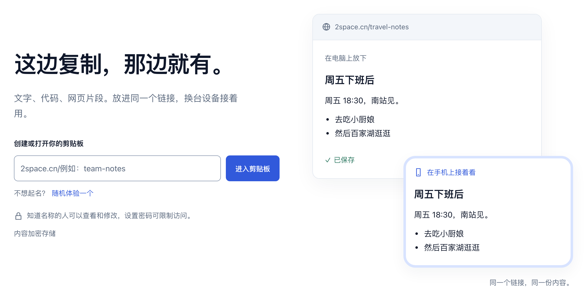
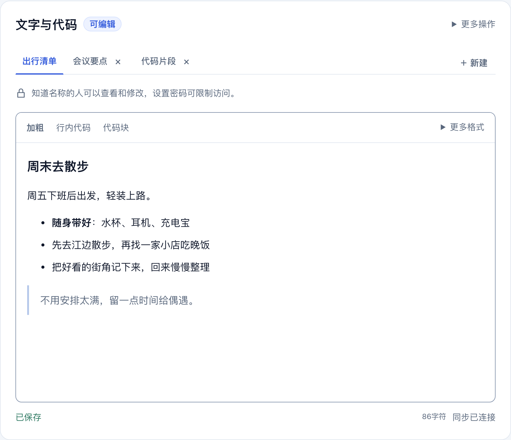
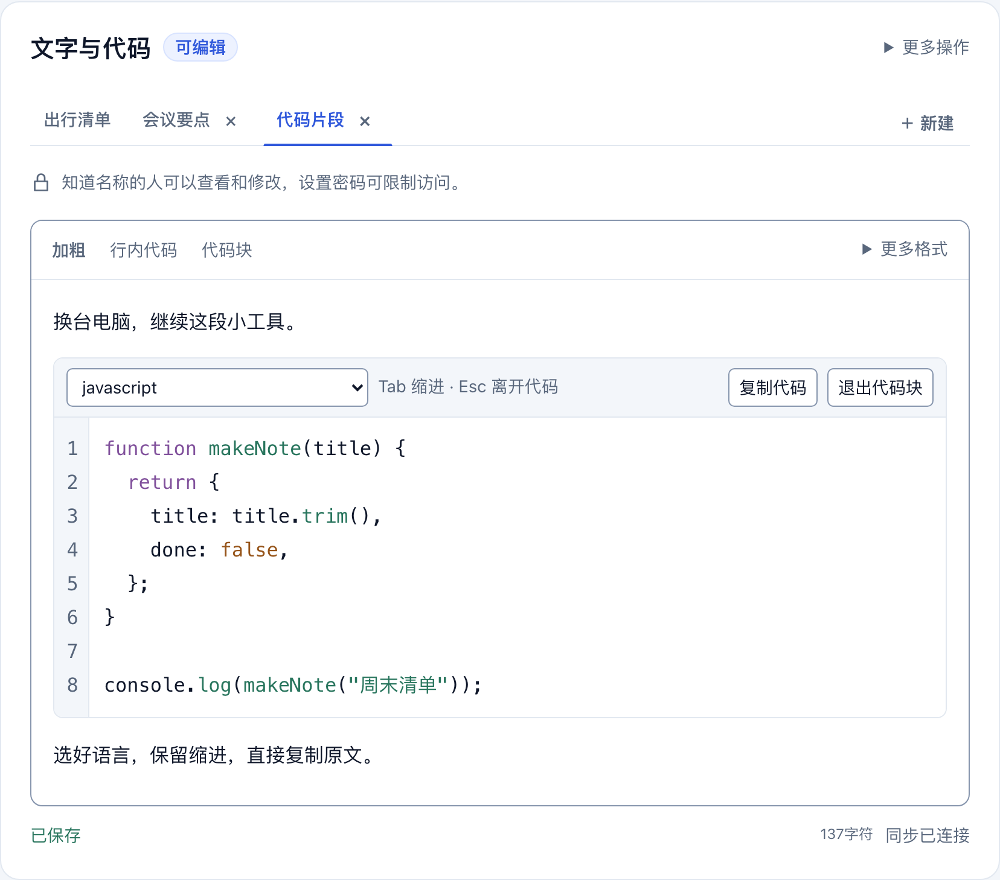
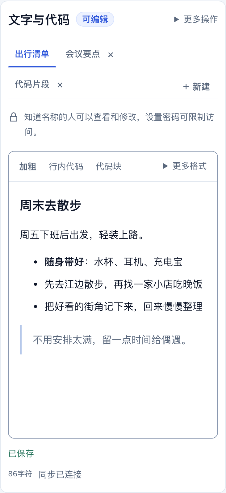

# 别再给自己发消息了，试试这个跨设备剪贴板

> 让一段内容，少走几次中转。

手机上复制了一段地址，电脑上要用；电脑里整理好一份清单，出门又想在手机上看。于是打开聊天软件，发给自己，再到另一台设备里翻出来。

这件小事，我们每天可能重复好几遍。2Space 想把它变得更直接：**这边复制，那边就有。** 把文字粘进网页，换台设备打开同一个空间，就能接着看、接着用。不用注册账号，也不用安装客户端。

## 取个名字，换台设备接着用

打开 2Space，给空间取一个由字母、数字、下划线或中划线组成的名字，就能进入。懒得起名，也可以先随机体验一个。

把地址、网页摘录或临时想到的一句话放进去，等页面显示“已保存”。另一台设备打开同一个地址，内容就在那里；两边都开着时，修改也会自动更新，不必反复刷新或重新发送。

适合那些**只差一个中转站**的小任务：手机上发现的资料，放到电脑继续整理；电脑上写好的出行安排，带到手机边走边看。它不会自动读取系统剪贴板，需要你主动粘贴。

## 文字有条理，代码也有样子

一段内容有时不只是几行纯文字。标题、重点、列表和引用，能让一份清单读起来轻松很多。2Space 支持轻量富文本，粘贴常用格式时，不用把所有层次重新排一遍。

写代码的人，也可以把命令或函数放进代码块，选择语言，保留缩进并查看语法高亮。需要时单独复制代码原文，少一次从聊天记录里修换行的麻烦。

一个空间最多放**六个记事本**，可以命名、调整顺序。出行清单、会议要点、代码片段各占一页，随手放下的内容也有自己的位置。需要留一份到本机，还能下载为文字文件。

## 分享方便，也把访问范围想清楚

想让另一台设备打开，可以复制链接，也可以扫码。临时和朋友核对一份安排，发出同一个入口，比来回传几个不同版本省事。

普通名称空间里，知道名称的人可以查看和修改；“仅查看链接”提供的是阅读模式，不能把它当成独立的访问权限。需要限制访问时，可以为整个空间设置密码。

通过新版界面设置密码后，内容会在浏览器里加密，再保存到服务端。**普通空间和密码保护空间的保护方式不同**，不必把所有内容都当成同一种分享。密码忘记无法找回，也请别用它存放账号密码、证件或重要资料的唯一副本。

## 下一次需要中转文字时，就试一次

用起来只要三步：打开网站，取个名字；粘贴内容，等“已保存”；换台设备打开同一个地址，继续使用。

它现在专注文字、富文本和代码，暂不传图片或任意文件。对一份临时清单、一段要带走的代码、几个待整理的想法来说，这样的轻量刚刚好。

下次准备给自己发消息前，试试先把那段文字放到这里：**https://2space.cn**。让内容跟着你走，也让设备之间少一点来回折腾。

---

我是 {{作者名}}，{{简介}}。

如果你觉得今天这篇有收获，欢迎点赞、在看、转发三连，我们下篇见。
